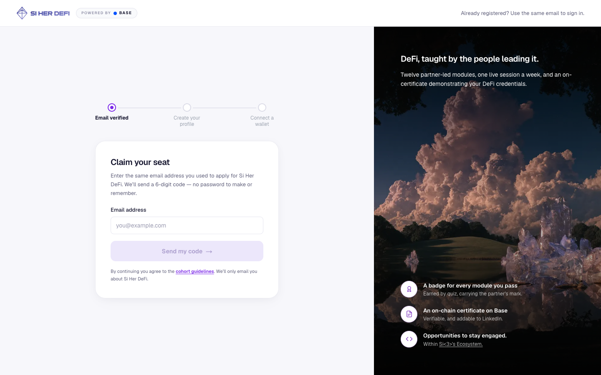
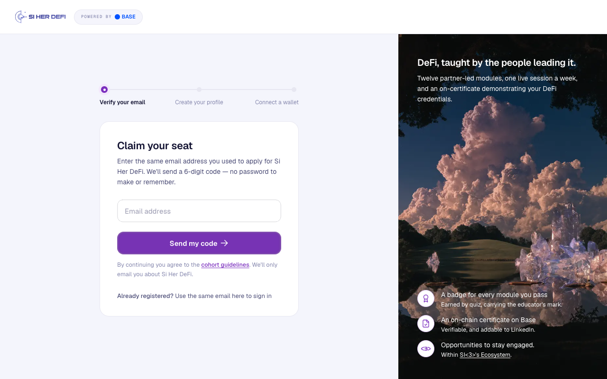

# 01 · Sign in — "Claim your seat"

**Figma:** Post-UX-Fixes → Email sign up → `01 · Sign up — default` (node `1023:234`)
**Live route:** `/siherdefi` and `/siherdefi/login`
**Prototype:** `src/app/login/page.tsx`

| | Before (live) | After (prototype) |
|---|---|---|
| Desktop |  |  |
| Mobile |  |  |

States (focus, typing, filled, empty error, invalid email, loading, hover, keyboard focus): `after-states.jpg`. Classic field variant: `after-classic-field.jpg`.

## What changed

1. **Layout.** The white nav (72px) spans the full width. The artwork rail (440 of 1280) fills the height below it. The column of steps and card is centred on `#f4f5fc`, 110px below the nav.
2. **Nav.** New logo (`public/v2/logo-si-her-defi.svg`). The "POWERED BY · BASE" pill is in Geist Mono 9px, tracking 1.08px, `#8688ae`. "Already registered?" moved out of the nav and into the card (fixes the mobile overlap, IMPROVEMENTS #5).
3. **Steps.** The labels read "Verify your email / Create your profile / Connect a wallet", so the first step no longer claims the email is verified before it is (IMPROVEMENTS #11). The current step is a 14px `#7b2fbe` dot with a white core and a 24px `#f3e8fc` halo. Upcoming steps are 10px `#e7e7f1` dots on a 2px `#e7e7f1` track. Labels align left / centre / right.
4. **Card.** White, `#e7e7f1` border, radius 20, padding 36/36/32.
   - Title: Geist SemiBold 22/28, tracking −0.33.
   - Body: 14/22 `#4c4d77`.
   - Helper: 12.5/20 `#8688ae`, link Medium `#7b2fbe`.
   - Footer: "Already registered? Use the same email here to sign in", 13px `#4c4d77`.
5. **Primary button.** The Figma `Button · Primary` component (`1025:32`) in every state. CSS is in `globals.css` → `.btn-primary`; the component is `src/components/ui/Button.tsx`.
   - The button **stays enabled** when the field is empty, as in the Figma default. Submitting empty or malformed input explains the problem under the field ("Enter the email address you applied with." / "Please enter a valid email address."). The live app greys the button out instead.
   - Loading shows a spinner and "Sending code…".
6. **Email field (trial).** Bencho's floating-label input (MIT): `src/components/ui/LabelInput.tsx` + `globals.css` → "Label input".
   - The label "Email address" sits in the field and lifts into the top border on focus.
   - The outline turns brand purple on focus and red on error.
   - Its height (48) and radius (12) come from the Figma field.
   - The plain Figma field (label above, 48px input, radius 12) is still available: switch it in Prototype controls → "Sign-in email field".
7. **Artwork rail copy.** "carrying the **educator's** mark" (was "partner's"). New certificate and `<3>` icons from Figma (`public/v2/`).

## Responsive
- **< 1024px:** the rail moves below the form, at least 460px tall, with a soft top/bottom shade so the text stays readable on the new crop.
- **< 640px:** the nav is 64px with 16px gutters; the card padding is 20/28/24 with radius 16; the step labels drop to 11px.
- Checked at 360, 390, 834, 1280 and 1440 wide.

## Still open
- The Figma copy still says "an **on**-certificate" (IMPROVEMENTS #6). It's kept as designed; it probably should be "an on-chain certificate".
